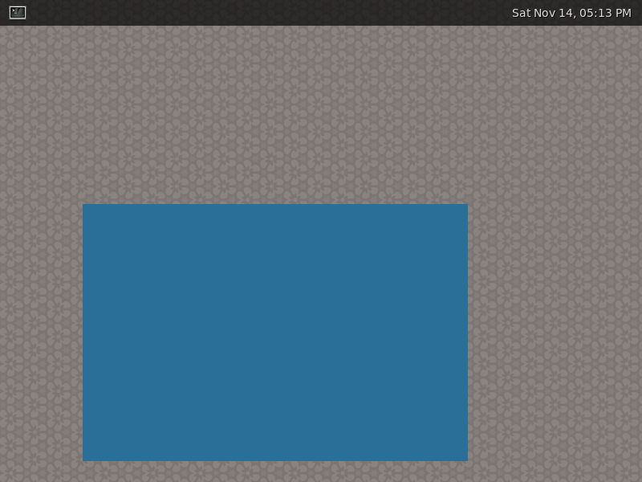

# filnix-wayland-example

This is a small C++ Wayland program built with [Fil-C](https://fil-c.org), the
memory-safe implementation of C and C++, using
[Filnix](https://github.com/mbrock/filnix). The program and every library it
links, including glibc, libc++, libwayland-client, libxkbcommon and libdbus-1,
are compiled with Fil-C. Build tools such as CMake and wayland-scanner are
ordinary programs.

When it runs, the program asks the D-Bus session bus for a name, opens a teal
window on your Wayland desktop, and prints the keys you press. Press Escape or
close the window to quit.



The window has no title bar because the program draws no decorations of its
own. Under GNOME you can move it with Super and drag.

## Setting up Nix

Install Nix with the Determinate installer, which works on Fedora with
SELinux and on most other x86-64 Linux distributions, and enables flakes:

``` bash
curl -fsSL https://install.determinate.systems/nix | sh -s -- install
```

Then turn on the Filnix binary cache, so that Nix downloads the Fil-C compiler
and libraries instead of building LLVM and glibc on your machine:

``` bash
sudo tee -a /etc/nix/nix.custom.conf <<'EOF'
extra-substituters = https://filc.cachix.org
extra-trusted-public-keys = filc.cachix.org-1:8rA7kXyu1HaJuMTsAKfA9fU/+r8YtLv5KiZ5hfDNZMk=
EOF
sudo systemctl restart nix-daemon
```

If you installed Nix another way, put the same two lines in
`/etc/nix/nix.conf` instead.

## Running the example without cloning it

``` bash
nix run github:mbrock/filnix-wayland-example
```

The first run downloads about 700 MB from the caches and compiles only this
program.

## Building the example yourself

``` bash
git clone https://github.com/mbrock/filnix-wayland-example
cd filnix-wayland-example
nix develop
cmake -B build -G Ninja
cmake --build build
./build/hello-wayland
```

`nix develop` opens a shell described by [flake.nix](flake.nix). In it, `cc`,
`c++`, `$CC` and `$CXX` are the Fil-C compiler, and `pkg-config` and CMake's
`pkg_check_modules` find the Fil-C libraries, so no CMake toolchain file is
needed. [CMakeLists.txt](CMakeLists.txt) is plain CMake that would work with
any compiler.

The program runs from your normal terminal, inside or outside the shell. It
loads the Fil-C loader and libraries from `/nix/store` and finds your desktop
through `WAYLAND_DISPLAY`, `XDG_RUNTIME_DIR` and `DBUS_SESSION_BUS_ADDRESS`,
which your desktop session already sets. If you run `nix-collect-garbage`,
enter `nix develop` again before running a binary you built yourself, because
garbage collection can delete libraries that no shell is using.

## Using the flake in your own project

Copy `flake.nix` into your project and edit the two lists in it.
`nativeBuildInputs` holds the tools that run during the build, and
`buildInputs` holds the libraries your program links. Library names are
nixpkgs attribute names, which <https://search.nixos.org/packages> finds. If
`pkg-config` reports a library outside `/nix/store`, that library is missing
from `buildInputs`. If your project is a Git repository, `git add flake.nix`,
because Nix only sees files that Git tracks.

`flake.lock` pins the Filnix revision. `nix flake update` moves it to the
latest Filnix.
